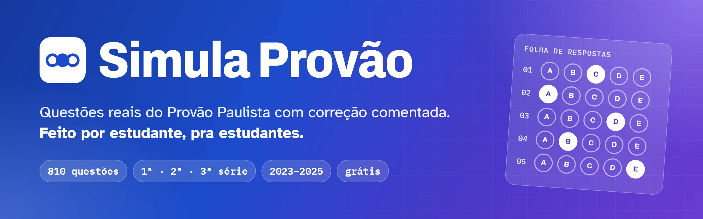
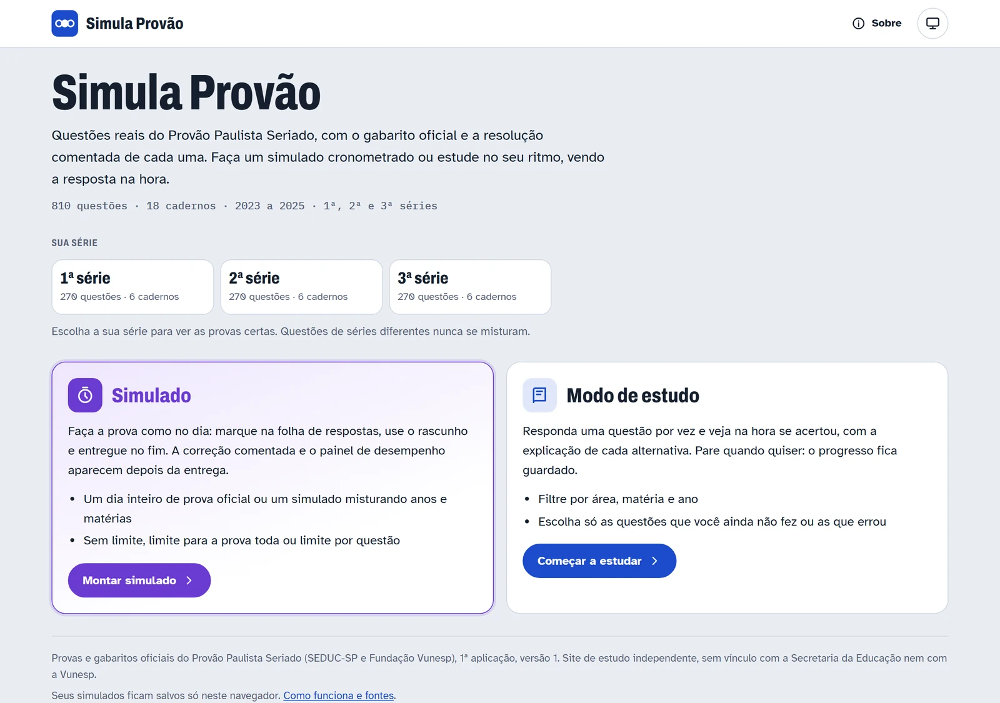
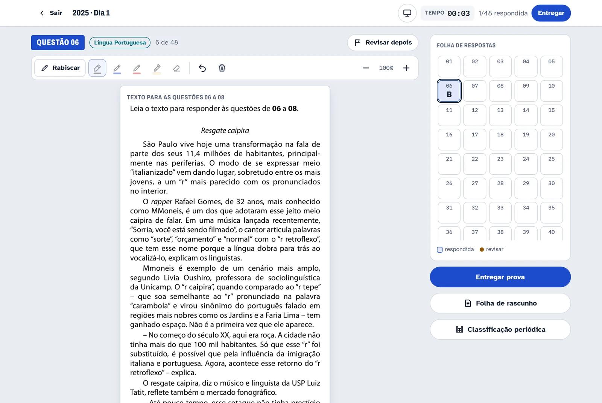
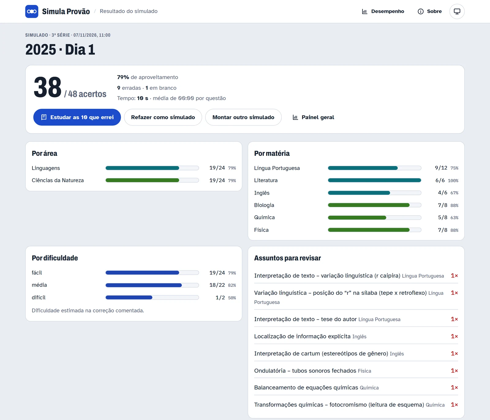
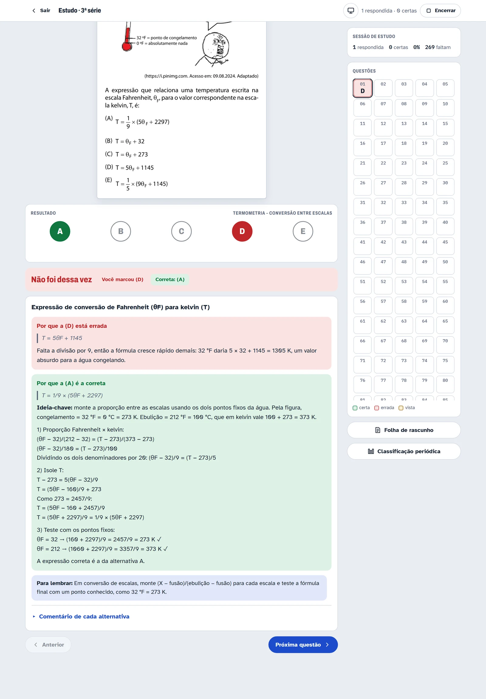

  

  
  
  

  <b>Questões reais do Provão Paulista Seriado, com gabarito oficial e resolução comentada de cada uma.</b> 
  Faça um simulado cronometrado ou estude no seu ritmo, vendo a resposta na hora.

---

## 👋 Oi!

O **Simula Provão** é um projeto **feito por estudante, pra estudantes**.

Na hora de estudar pro Provão Paulista, as provas antigas estavam todas lá, mas espalhadas em PDF, sem explicação, e corrigir na mão o gabarito de 48 questões não é exatamente divertido. Então juntei tudo num lugar só: dá pra fazer a prova como se fosse o dia de verdade, ver na hora onde errou e entender **por que** errou.

É de graça, não tem cadastro, não tem anúncio. Só abrir e estudar. 📚

  <a href="https://fafa132.github.io/simulado-provao-paulista/">
    <picture>
      <source media="(prefers-color-scheme: dark)" srcset=".github/readme/home-dark.webp">
      
    </picture>
  </a>

## ✨ O que tem

| Recurso | O que faz |
|---|---|
| 📝 **810 questões reais** | Todas as provas de **2023, 2024 e 2025**, dos dois dias, pra **1ª, 2ª e 3ª série**. Cada série tem as suas provas; nada se mistura. |
| ⏱️ **Simulado** | Faça um dia inteiro de prova oficial ou monte o seu, misturando anos e matérias. Com folha de respostas, rascunho e cronômetro (sem limite, limite pra prova toda ou por questão). |
| 📖 **Modo de estudo** | Uma questão por vez, com a resposta na hora. Filtre por área, matéria e ano, ou escolha só as que você ainda não fez ou as que errou. |
| 💬 **Correção comentada** | Resolução passo a passo, explicação de cada alternativa (inclusive das erradas) e uma dica de "pra lembrar". |
| 📊 **Painel de desempenho** | Acertos por área, matéria e dificuldade, e a lista dos assuntos em que você mais erra, com um botão pra refazer só essas questões. |
| ✏️ **Rabiscar na questão** | Lápis, marca-texto e borracha direto na prova, além de riscar alternativas, como no papel. |
| 🌙 **Tema claro e escuro** | Segue o seu celular ou computador, ou você escolhe. |
| 📱 **Funciona no celular** | Dá pra estudar no ônibus. |

## 📸 Por dentro

<table>
  <tr>
    <td width="50%" valign="top">
      <b>Simulado</b> 
      Folha de respostas, "revisar depois", cronômetro e tabela periódica no Dia 1.  
      
    </td>
    <td width="50%" valign="top">
      <b>Resultado</b> 
      Nota, desempenho por área e matéria e os assuntos pra revisar.  
      
    </td>
  </tr>
</table>

  <b>Correção comentada</b> 
  Errou? A explicação mostra por que a sua alternativa não serve e como chegar na certa.  
  

## 🚀 Como usar

1. Abra **[fafa132.github.io/simulado-provao-paulista](https://fafa132.github.io/simulado-provao-paulista/)**.
2. Escolha a sua série.
3. Vá de **Simulado** pra treinar como no dia da prova, ou de **Modo de estudo** pra ir com calma.

Seu progresso fica salvo **só no seu navegador**: não precisa de conta e nada é enviado pra lugar nenhum. (Se limpar os dados do navegador ou trocar de aparelho, o histórico começa do zero.)

## 🤖 Sobre a correção comentada

As provas e os gabaritos são os **oficiais**. Já as resoluções, os comentários de cada alternativa, as dicas e a dificuldade estimada foram escritos com ajuda de **inteligência artificial (Claude, da Anthropic)**.

Pra diminuir a chance de erro, cada questão passou por três etapas: um primeiro texto, uma revisão feita por outra instância que resolveu a questão de novo sem olhar o rascunho e, quando as duas discordavam, uma terceira que decidia com base no gabarito oficial.

Mesmo assim pode ter escapado alguma coisa. **Achou um erro? [Abra uma issue](https://github.com/fafa132/simulado-provao-paulista/issues/new)** dizendo a prova e o número da questão. Isso ajuda todo mundo que estuda por aqui. 🙏

## 🤝 Quer ajudar?

- ⭐ Dê uma estrela no repositório.
- 📲 Mande o link pro grupo da sala.
- 🐞 Avise se achar erro em alguma questão ou explicação.
- 💡 Tem uma ideia? Abre uma issue também.

## 📄 Fontes e aviso

Provas e gabaritos oficiais do **Provão Paulista Seriado** (SEDUC-SP e Fundação Vunesp), 1ª aplicação, versão 1. A lista com o link de cada PDF original está na página **[Sobre](https://fafa132.github.io/simulado-provao-paulista/#sobre)** do site.

Este é um **site de estudo independente**, sem vínculo com a Secretaria da Educação do Estado de São Paulo nem com a Vunesp.

---

  Feito com 💜 e muito café por estudante, pra estudantes. 
  <b>Boa prova!</b>

